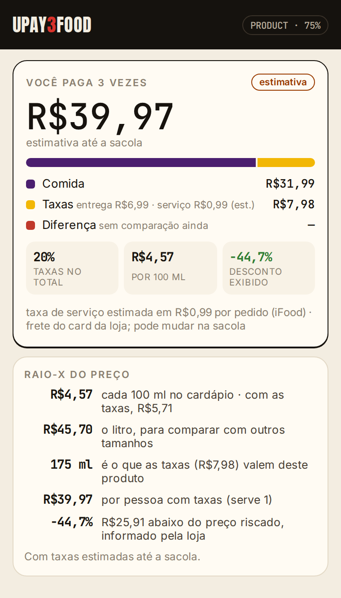
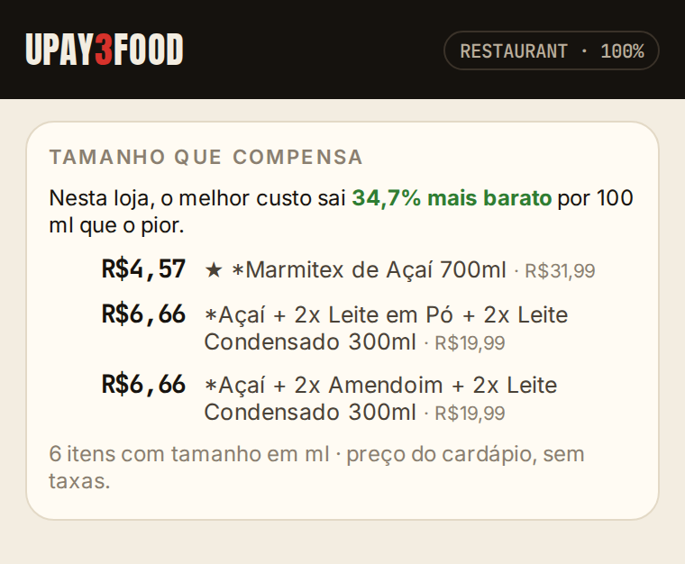

# UPAY3FOOD

> **You pay 3 times for food:** the food, the fees, and the difference to the
> cheapest option. In Portuguese, *“Você paga 3 vezes pela comida”*.

UPAY3FOOD shows all three on iFood. A browser extension reads the page the user
already sees, ranks the whole menu per litre and per gram, outlines the item
worth buying and takes the user to it. A public MCP server lets any AI agent do
the same math. The calculation rules are hashed and anchored on Solana, and
purchase funding can be shielded with USDC through Cloak.

Built for the Colosseum Crypto World's Fair hackathon. Not affiliated with
iFood, Rappi, 99Food or Keeta.

| | |
|---|---|
| Site | https://upay3food.com |
| Install the extension | https://upay3food.com/instalar |
| MCP server (for agents) | `https://upay3food.com/api/mcp` · [setup](https://upay3food.com/agentes) |
| Transparency (Solana anchor) | https://upay3food.com/transparencia |
| Documentation | https://docs.upay3food.com |
| Mainnet proof (Cloak shield) | [docs/08-proofs/2026-10-05-mainnet-shield.md](docs/08-proofs/2026-10-05-mainnet-shield.md) |
| Mainnet proof (rules anchor) | [docs/08-proofs/2026-10-11-transparency-anchor.md](docs/08-proofs/2026-10-11-transparency-anchor.md) |

<p align="center">
  
  
</p>

## What works today

| Area | State |
|---|---|
| **Extension** (Chrome, Edge, Brave; MV3) | Reads iFood shop, product and bag pages; shop pages work without login. Calibrated on real pages; regression tests use sanitized captures (commercial data only). |
| You pay 3 times | Food, fees and the difference to the cheapest comparable option, in integer cents. Menu prices are labelled as estimates until the bag confirms them. |
| Price X-ray | Per 100 ml, per litre, per 100 g of meat, per person, and how much of the product the fees are worth. |
| The size worth buying | The whole menu ranked per litre or per 100 g of meat; tubs, combos and drinks compared separately. |
| On-page highlight | Outlines the best item per litre and the item the agent picked, on iFood's own menu. |
| Explainable agent | “quero açaí 500ml até R$25” → cheapest estimated checkout, nearest size, best per litre and a link to the item. |
| **MCP server** | 9 tools + 1 prompt, Streamable HTTP, no login, stores nothing. Works with Claude, ChatGPT, Cursor and other MCP clients. |
| **Solana: transparency anchor** | SHA-256 of the methodology and of the calculation code, anchored as an SPL Memo on mainnet (slot 455501588); verifiable on /transparencia or with `sha256sum`. |
| **Solana: private funding** | 1.000000 USDC shielded into Cloak on mainnet (slot 453687294). |
| Solana RPC | All traffic goes through RPC Fast via a same-origin proxy with a method allowlist; no key reaches the browser. |
| Paying the order's Pix with USDC | **Not live.** The extension reads the Pix payload; settlement needs a licensed off-ramp partner and stays off until one exists ([ADR-006](docs/decisions/ADR-006-payments-without-token.md)). |
| Market board (`/market`) | Labelled synthetic demo until the observation network is published. Never mixed with real data. |

## Rules the product keeps

- **Reads only what the user sees**, in their own session. No private APIs, no
  intercepted traffic, no headless scraping ([ADR-007](docs/decisions/ADR-007-no-headless-scraping.md)).
- **Never orders or pays on its own.** The user always confirms.
- **No credentials or personal data**: no cookies, tokens, addresses, phone
  numbers or account data are read, stored or sent.
- **Money is integer cents**, and ranking uses the checkout total, never the item price alone.
- **Observations are not offers**, and synthetic data is always labelled.
- **Observational language**: we show numbers, not accusations about why prices differ.

## Repository layout

```
apps/
  extension/      Chrome MV3 extension: readers, popup, on-page highlight
  web/            Next.js site: home, install, agents (MCP server at /api/mcp), transparency, docs
  observer-api/   observation network ingestion and aggregation
  agent-api/      persistent agent runtime (event log, orchestration, SSE)
  cloak-cli/      private funding CLI: mainnet shield, balance, dry-run demo
packages/
  domain/         money, price layers, per-litre and per-gram math, page-text readers
  agent/          intent parser, menu advisor, decision engine
  market/         market summary and checkout comparison
  pay/            wallet connection, Cloak balance, Solana memo anchor
  payments/       Pix BR Code, Solana, off-ramp and Cloak adapters
  chain/          Solana RPC boundary (RPC Fast, server side)
  fixtures/       deterministic synthetic data for the demo board
docs/             product, architecture, decisions (ADRs), incidents, spikes, proofs
```

## Run it

Requires Node ≥ 20 and pnpm 10 (`corepack enable`).

```bash
pnpm install
pnpm check            # typecheck + tests + extension build + site build
pnpm build:extension  # → apps/extension/dist, then "Load unpacked" in chrome://extensions
pnpm dev:web          # site and MCP server on http://localhost:3000
pnpm demo:cloak       # private funding demo (simulated, no wallet)
```

Without `OBSERVER_API_URL`, the market board runs on the labelled synthetic demo.

## Documentation

- [Documentation index](docs/README.md) · [Product](docs/04-product/index.md) · [Architecture](docs/05-architecture/index.md)
- [Price calculations (methodology)](docs/05-architecture/price-calculations.md) · [Agents and MCP](docs/05-architecture/agents.md) · [Payments](docs/05-architecture/payments.md)
- [Data sources](docs/03-market/data-sources.md) · [Mobile plan](docs/04-product/mobile.md) · [Hackathon submission](docs/07-hackathon/submission.md)
- Decisions: [ADR-001](docs/decisions/ADR-001-delivery-first.md) · [ADR-002](docs/decisions/ADR-002-comparison-before-agency.md) · [ADR-003](docs/decisions/ADR-003-data-provenance.md) · [ADR-004](docs/decisions/ADR-004-rank-on-cart-total.md) · [ADR-005](docs/decisions/ADR-005-observation-is-not-an-offer.md) · [ADR-006](docs/decisions/ADR-006-payments-without-token.md) · [ADR-007](docs/decisions/ADR-007-no-headless-scraping.md)

## How it was built

Built during the hackathon: the repository was created on 2026-10-03 and every
commit is from then on. Development was AI-assisted: many commits are co-authored
with Claude (Anthropic's coding assistant), under the founder's direction and
review. Third-party code is used as dependencies, mainly `@cloak.dev/sdk`,
`mcp-handler`, `@solana/kit` and `@solana/web3.js`.

## License

MIT — see [LICENSE](LICENSE).
